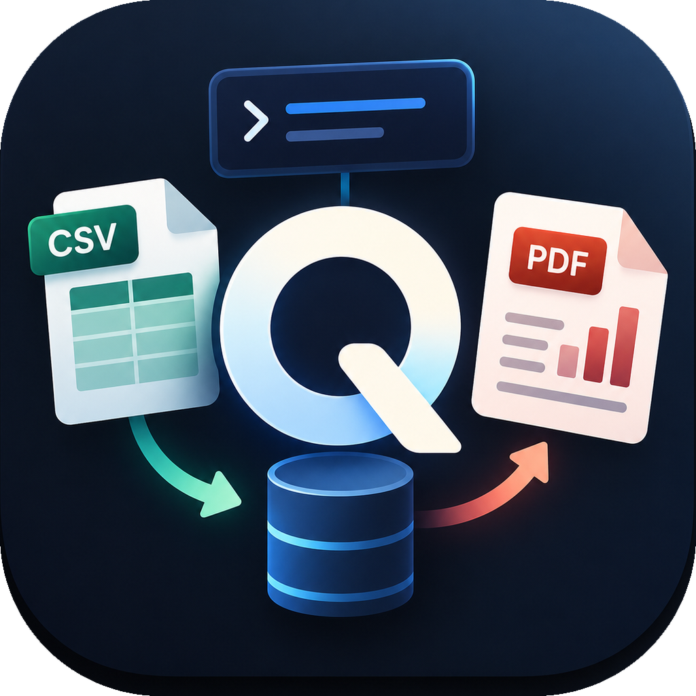
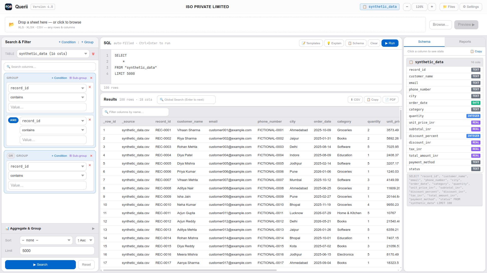
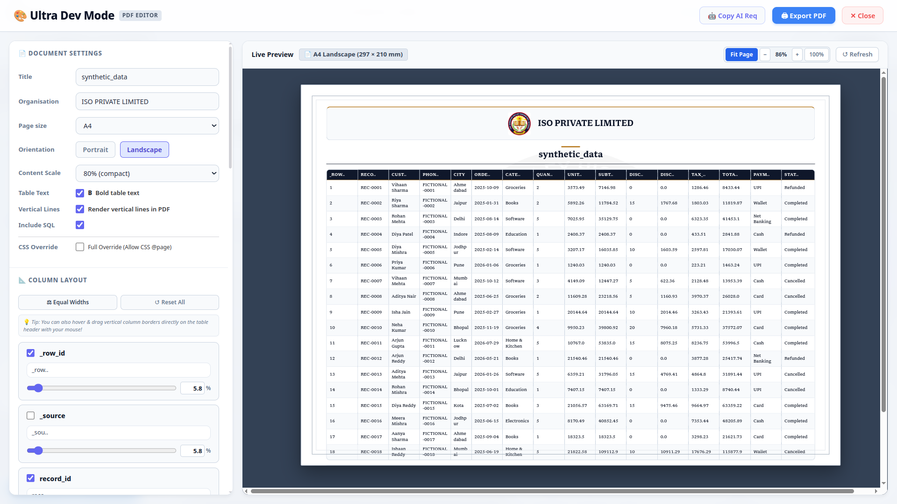
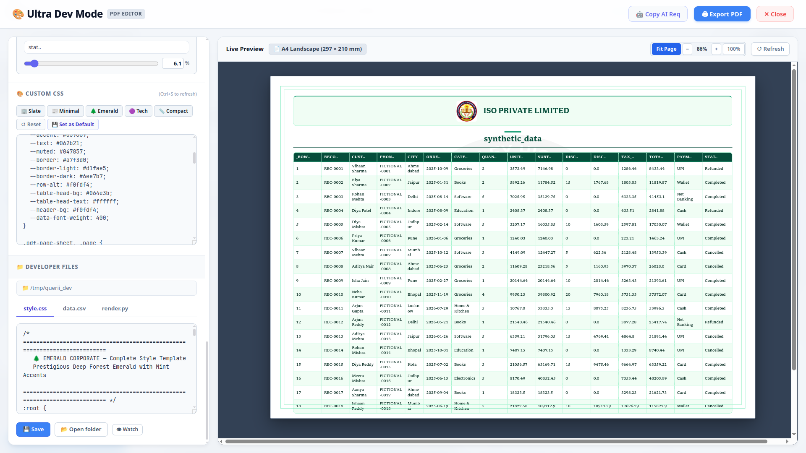
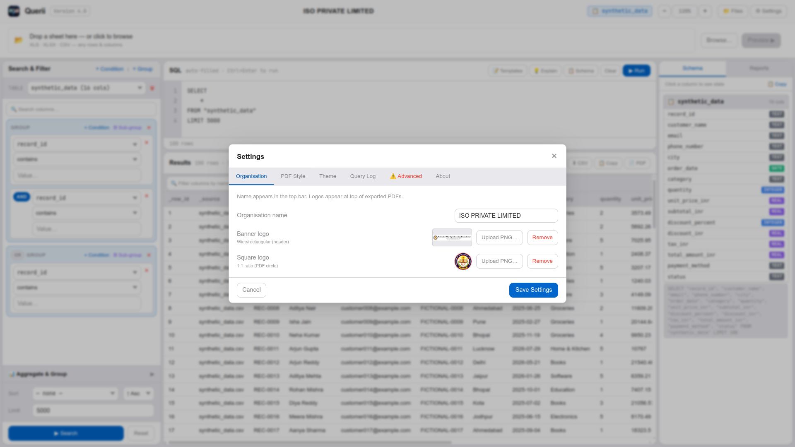

# ⚡ Querii — Version 4.2

<p align="center">
  
</p>

<p align="center">
  <strong>High-Velocity, Local-First SQL Analytics Workstation & Executive PDF Studio</strong>
</p>

<p align="center">
  
  
  
  
  
</p>

---

## 📖 Table of Contents

1. [Executive Overview & Systems Architecture](#-executive-overview--systems-architecture)
2. [What's New in Version 4.2](#-whats-new-in-version-42)
3. [Engineering Highlights & Technical Pillars](#-engineering-highlights--technical-pillars)
4. [Dual-Engine PDF Architecture](#-dual-engine-pdf-architecture)
   - [Engine 1: Native Rust Vector Engine (`<35ms`)](#engine-1-native-rust-vector-engine-35ms)
   - [Engine 2: Executive Headless Chromium Studio](#engine-2-executive-headless-chromium-studio)
   - [Engine 3: Universal Fallback Guarantee (ReportLab)](#engine-3-universal-fallback-guarantee-reportlab)
5. [Interactive Spreadsheet CSV Studio](#-interactive-spreadsheet-csv-studio)
   - [Batch Numeric Row & Column Mutation](#batch-numeric-row--column-mutation)
   - [Accessible Inline & Toolbar Deletions](#accessible-inline--toolbar-deletions)
   - [Direct Clipboard Matrix Ingestion](#direct-clipboard-matrix-ingestion)
6. [Ultra Dev Mode & Executive PDF Studio](#-ultra-dev-mode--executive-pdf-studio)
   - [Token-Aware Auto-Width & Header Shortening Heuristic](#token-aware-auto-width--header-shortening-heuristic)
   - [Virtual Export Rows & Columns (Non-Mutating)](#virtual-export-rows--columns-non-mutating)
   - [Physical Sheet Geometry & Zoom Presets](#physical-sheet-geometry--zoom-presets)
   - [Interactive Mouse Drag Column Resizing](#interactive-mouse-drag-column-resizing)
   - [Numeric Keyboard Width Inputs](#numeric-keyboard-width-inputs)
   - [Branding Synchronization & Logo Toggle](#branding-synchronization--logo-toggle)
   - [Executive Typography: Libron Font](#executive-typography-libron-font)
7. [Custom CSS Architecture & Style Cascade](#-custom-css-architecture--style-cascade)
   - [Full Design Freedom Policy](#full-design-freedom-policy)
   - [Complete HTML Template Hierarchy](#complete-html-template-hierarchy)
   - [CSS Variables Reference (`:root`)](#css-variables-reference-root)
   - [5 Built-in Executive Presets](#5-built-in-executive-presets)
   - [The 6 Critical Hard Exceptions for Custom CSS](#the-6-critical-hard-exceptions-for-custom-css)
8. [AI Prompt Specification Generator](#-ai-prompt-specification-generator)
9. [Cross-Platform Native Clipboard Integration](#-cross-platform-native-clipboard-integration)
10. [Global Client-Side Search (Ctrl+F)](#-global-client-side-search-ctrlf)
11. [Settings & Organization Branding](#-settings--organization-branding)
12. [SQL Workspace & Database Connectivity](#-sql-workspace--database-connectivity)
13. [Project Directory Structure](#-project-directory-structure)
14. [Developer Guide, Compilation & Multi-Arch CI/CD](#-developer-guide-compilation--multi-arch-cicd)
    - [Prerequisites](#prerequisites)
    - [Running from Source](#running-from-source)
    - [Rebuilding the Rust PDF Engine](#rebuilding-the-rust-pdf-engine)
    - [Multi-Platform Packaging (macOS ARM/x64, Linux, Windows)](#multi-platform-packaging-macos-armx64-linux-windows)
15. [Keyboard Shortcuts Reference](#-keyboard-shortcuts-reference)
16. [Data Locations & Privacy](#-data-locations--privacy)

---

## 🌟 Executive Overview & Systems Architecture

**Querii Version 4.2** is an engineered-from-the-ground-up, local-first analytics workstation designed for software engineers, data architects, and executive teams requiring immediate data exploration, visual and freeform SQL query execution, spreadsheet authoring, and audit-grade PDF report compilation without cloud latency, third-party data transmission, or vendor lock-in.

Built with a modular IPC bridge over native OS webviews (`pywebview`), high-performance database adapters (SQLite, PostgreSQL, MySQL), an interactive spreadsheet state machine, and a **hybrid dual-engine compilation pipeline**, Querii bridges low-level systems performance (sub-35ms native Rust vector rendering) with publication-quality CSS Paged Media standards.

<p align="center">
  
  <br>
  <em><strong>Querii Main Interface (Dark Mode)</strong> — Visual Query Builder, Freeform SQL Editor, Dynamic Schema Drawer, and High-Performance Tabular Grid.</em>
</p>

---

## 🚀 What's New in Version 4.2

- 📊 **Next-Gen Spreadsheet CSV Studio:**
  - **Batch Numeric Row & Column Creation:** Dedicated numeric counters (`N`) next to `+ Row(s)` and `+ Col(s)` allow analysts to append arbitrary blocks of rows/columns with a single click.
  - **Accessible Row & Column Deletions:** Quick-action `🗑 Del Row` and `🗑 Del Col` toolbar buttons operating on active selection, paired with individual inline `×` removal buttons on each row number and column header cell.
  - **Spreadsheet Clipboard Integration:** Sub-millisecond copy-paste ingestion for raw CSV and TSV matrices, preserving column boundaries, quote escaping, and automatic header recognition.
- 📐 **Token-Aware Column Auto-Layout & Intelligent Header Shortening:**
  - **First-Token Heuristic:** Computes proportional baseline column widths from the largest first whitespace-delimited token (`str.split(/\s+/)[0]`) across column rows, preventing long multi-word strings from distorting layout proportions.
  - **Smart Name Shortening:** An interactive checkbox (`Auto-shorten column names if exceeding width`) automatically shortens headers exceeding content bounds (`abcd..`). Computed percentage widths immediately bind to sidebar sliders and numeric percentage inputs.
- 📄 **Virtual Export Rows & Columns (Non-Mutating):**
  - **Extra Blank Rows:** Injects `N` empty signature/handwriting rows into exported PDF sheets without altering underlying SQLite tables.
  - **Custom Export Columns:** Allows appending ad-hoc columns (e.g. *Signature*, *Approval*, *Notes*) exclusively to the publication document.
- 🏢 **Dynamic Branding & Watermark Synchronization:**
  - Changing the organization in Ultra Dev Mode or the export dialog immediately synchronizes document headings and dense anti-tamper watermark patterns.
  - Added dedicated **Include Logo** toggle controlling branding across both the masthead and background watermarks.
- 🍎 **Universal Multi-Architecture macOS & Windows Packaging:**
  - **Native Apple Silicon (`arm64`):** Compiled natively on macOS 14 runners for M1, M2, M3, and M4 Apple Silicon architectures.
  - **Native Intel (`x86_64`):** Compiled on macOS 13 runners for legacy Intel Mac machines.
  - **Windows Uninstaller Registration:** Updated Inno Setup installer script with dedicated Start Menu and system uninstaller shortcuts (`{uninstallexe}`).

---

## ⚡ Core Highlights & Capabilities

| Capability | Description |
|---|---|
| **Dual-Engine PDF** | Choose between the **Native Rust Vector Engine** (<35ms) and the **Executive Chromium Studio** (<1.5s) with ReportLab fallback. |
| **Ultra Dev Mode** | Fullscreen IDE for live PDF styling with split-pane code editor, responsive zoom, and instant live preview. |
| **Global Search** | Browser-grade client-side `Ctrl+F` with dynamic text highlights across thousands of table cells. |
| **Smart Schema Explorer** | Click any column in the schema drawer to insert it into the SQL editor with smart leading comma handling. |
| **Multi-Database Support** | Seamlessly connect to local SQLite databases, PostgreSQL instances, and MySQL clusters. |
| **Visual Query Builder** | Construct multi-condition filter groups (`AND`/`OR`), joins, sorting, and aggregations without writing SQL manually. |
| **Theme Engine** | Adaptive Dark, Light, and System themes with customizable accent palettes and responsive layouts. |

---

## 🛠️ Dual-Engine PDF Architecture

Querii solves the traditional trade-off between **compilation speed** and **visual expressiveness** by providing two independent rendering pipelines:

```
                            ┌─────────────────────────────────┐
                            │   Frontend PDF Export Trigger   │
                            └────────────────┬────────────────┘
                                             │
                      ┌──────────────────────┴──────────────────────┐
                      ▼                                             ▼
       ⚡ Native Rust Engine (<35ms)                🎨 Executive Chromium Studio (<1.5s)
       • Binary: core/querii-pdf                    • Headless Google Chrome / Chromium
       • Zero dependencies, pure vector graphics    • Full CSS3, Paged Media & Flexbox
       • Multi-page pagination calculation          • 100% Custom CSS override freedom
       • Deterministic column width auto-scaling    • 5 Built-in Executive style presets
       • Output: Ultra-compact vector PDF           • Live iframe preview with zoom controls
                      │                                             │
                      └──────────────────────┬──────────────────────┘
                                             │ (Fallback if Chromium missing)
                                             ▼
                              Universal ReportLab Engine
```

### Engine 1: Native Rust Vector Engine (`<35ms`)
- **Binary:** Located at [`core/querii-pdf`](file:///home/heisenberg/BuilderValley/querii/core/querii-pdf), written in Rust using `printpdf` and `serde_json`.
- **Performance Benchmark:** Compiles a **1,000-record dataset across 28 pages in 33.36 ms** (over 350× faster than Python-based WeasyPrint).
- **Execution Model:** Receives structured JSON via `--stdin` or temporary file, performs deterministic page-break mathematics, repeats table headers across pages, and writes a zero-dependency, ultra-compact vector PDF.

### Engine 2: Executive Headless Chromium Studio
- **Engine:** Automatically discovers local installations of Google Chrome, Chromium, or Brave on Linux, macOS, and Windows.
- **Visuals:** Publication-grade reporting with executive mastheads, dual accent lines, repeating table headers (`<thead>`), alternating zebra rows, and metadata matrices.
- **CSS Cascade:** Injects user-defined CSS at the end of `<head>` without blocking the desktop event loop.

### Engine 3: Universal Fallback Guarantee (ReportLab)
- If headless Chromium is not present in the host operating system, Querii automatically falls back to ReportLab to ensure that an export request **never fails silently**.

---

## 🎨 Ultra Dev Mode & Interactive PDF Studio

The Ultra Dev Mode (`web/pdf_dev_mode.js`) is an interactive design environment tailored for crafting corporate report layouts.

<p align="center">
  
  <br>
  <em><strong>Ultra Dev Mode PDF Studio</strong> — Real-page physical sheet preview (A4/A3/Letter), live CSS editor, column width drag handles, and instant rendering controls.</em>
</p>

```
┌─────────────────────────────────────────────────────────────────────────────────┐
│ [← Back]  📄 A4 Portrait — 210 × 297 mm   [Fit Page] [75%] [100%]   [Export PDF]│
├────────────────────────────────────────┬────────────────────────────────────────┤
│ 🛠️ CONTROLS & CODE EDITOR              │ 👁️ LIVE REAL-PAGE PREVIEW              │
│                                        │                                        │
│ 1-Click Presets:                       │   ┌────────────────────────────────┐   │
│ [🏢 Slate] [📰 Minimal] [🌲 Emerald]   │   │ ACME CORPORATION               │   │
│ [🟣 Tech]  [📏 Compact]                │   │ Executive Analytics Summary    │   │
│                                        │   ├────────────────────────────────┤   │
│ [x] Bold Table Data                    │   │ ID  | Customer | Amount | Date │   │
│ [x] Vertical Grid Lines                │   │ 001 | Acme Inc | $4,200 | May  │   │
│                                        │   │ 002 | Globex   | $1,850 | Jun  │   │
│ Column Width Resizing (Hold & Drag)    │   │                                │   │
│ [Col 1: 25% ] [Col 2: 35% ] ...        │   │                                │   │
│                                        │   └────────────────────────────────┘   │
│ CSS Editor (Ctrl+S to Refresh):        │                                        │
│ .school-header { background: #0f172a } │                                        │
└────────────────────────────────────────┴────────────────────────────────────────┘
```

### Physical Sheet Geometry & Zoom Presets
Unlike web previews that stretch continuously across the viewport, Ultra Dev Mode renders the document within an exact physical paper viewport:
- **A4:** `210 mm × 297 mm` (Portrait) or `297 mm × 210 mm` (Landscape)
- **A3:** `297 mm × 420 mm` (Portrait) or `420 mm × 297 mm` (Landscape)
- **Letter:** `216 mm × 279 mm` (Portrait) or `279 mm × 216 mm` (Landscape)

The header toolbar provides instant zoom controls:
- **Fit Page:** Dynamically computes the scale factor to display the full sheet within the available viewport height.
- **75% Zoom:** High-density overview.
- **100% Zoom:** Pixel-accurate 1:1 physical print preview.
- **Paper Info Badge:** Live status showing current page format and dimensions (e.g. `📄 A4 Portrait — 210 × 297 mm`).

### Interactive Mouse Drag Column Resizing
- Hover over any column border in the table header to reveal the `col-resize` grab handle.
- Click and drag horizontally with the mouse to resize columns.
- The resizing algorithm adjusts the target column while inversely modifying the adjacent column, strictly maintaining **100% total table width** and preventing horizontal clipping.

### Numeric Keyboard Width Inputs
Every column in the sidebar features both a responsive slider and a numeric percentage input (`%`). Type a value directly with the keyboard to set exact dimensions.

### Bold Data & Vertical Grid Line Toggles
- **Bold Table Data:** Toggles `--data-font-weight` between `400` (regular) and `700` (bold) across all table cells.
- **Vertical Grid Lines:** Adds vertical border separators (`1px solid var(--border)`) between columns in both the live preview and final PDF output.

### Executive Typography: Libron Font
Querii includes the **Libron** serif typography suite bundled directly via `@font-face` with full support for Regular (400), Bold (700), and Italic styles. Fallbacks gracefully cascade to Georgia and system serif fonts.

---

## 🖌️ Custom CSS Architecture & Style Cascade

### Full Design Freedom Policy
Querii gives you complete styling freedom. Custom CSS is appended at the very end of the document's `<style>` block and is **never** restricted by hardcoded `!important` declarations. You can override headers, mastheads, zebra striping, borders, paddings, and page margins.

### Complete HTML Template Hierarchy

When styling custom reports, refer to this exact DOM structure emitted by the rendering engine:

```html
<!DOCTYPE html>
<html lang="en">
<head>
  <style>
    /* 1. Bundled Font Declarations (@font-face Libron) */
    /* 2. Base CSS Variables (:root) */
    /* 3. Base Document & Layout Styles */
    /* 4. USER CUSTOM CSS INJECTED HERE (Last in cascade) */
  </style>
</head>
<body>
  <main class="page">
    <!-- Outer decorative frame (hidden if no border styled) -->
    <div class="document-frame" aria-hidden="true"></div>

    <!-- Repeating Watermark Zone -->
    <div class="watermark-area" id="watermarkArea" aria-hidden="true">
      <div class="watermark-text" id="watermarkText"></div>
      <div class="logo-watermark-zone">
        
      </div>
    </div>

    <!-- Executive Masthead / Header -->
    <header class="school-header">
      
      <div class="school-info">
        <h2>Organization Name</h2>
        <div class="school-meta">
          <span>Metadata Item 1</span>
          <span>Metadata Item 2</span>
        </div>
      </div>
    </header>

    <!-- Document Heading & Accent -->
    <section class="document-heading">
      <div class="heading-accent"></div>
      <h1 class="title">Report Title</h1>
      <div class="gen-date">Generated: 10 Oct 2026, 03:45 PM</div>
    </section>

    <!-- Data Table Container -->
    <div class="data-table-wrap">
      <table class="data-table">
        <colgroup>
          <col class="col-0" data-col="id">
          <col class="col-1" data-col="name">
        </colgroup>
        <thead>
          <tr>
            <th data-col="id" data-idx="0"><span class="th-content">ID</span></th>
            <th data-col="name" data-idx="1"><span class="th-content">Name</span></th>
          </tr>
        </thead>
        <tbody>
          <tr class="even">
            <td data-col="id">101</td>
            <td data-col="name">Enterprise Corp</td>
          </tr>
          <tr class="odd">...</tr>
        </tbody>
      </table>
    </div>

    <!-- Footer Summary -->
    <footer class="report-footer">
      Total Records: 1,240  |  Source: Primary DB  |  Querii
    </footer>

    <!-- Optional SQL Query Section -->
    <section class="sql-block">
      <div class="sql-label">SQL Query</div>
      <pre class="sql-pre">SELECT * FROM customers;</pre>
    </section>
  </main>
</body>
</html>
```

### CSS Variables Reference (`:root`)

Override these variables in your custom CSS to restyle the entire document with minimal code:

```css
:root {
  --navy: #090d16;             /* Primary masthead color, main headings & dark borders */
  --navy-light: #1e293b;       /* Secondary brand tone */
  --accent: #2563eb;           /* Underline accent bar & badge highlights */
  --accent-subtle: #eff6ff;    /* Subtle highlight fills */
  --border: #e2e8f0;           /* Table cell borders & horizontal rules */
  --border-dark: #cbd5e1;      /* Table perimeter border */
  --text: #090d16;             /* Base body text */
  --text-muted: #64748b;       /* Metadata, kickers, and timestamps */
  --row-alt: #f8fafc;          /* Alternating zebra row background */
  --table-head-bg: #090d16;    /* Table header background */
  --table-head-text: #ffffff;  /* Table header text color */
  --data-font-weight: 400;     /* Table data font weight (400 regular, 700 bold) */
}
```

### 5 Built-in Executive Presets

Querii includes five pre-crafted presets accessible in both the PDF Export Modal and Ultra Dev Mode:

1. **🏢 Slate:** Corporate palette with deep navy mastheads, gold accent underlines, and crisp gray borders.
2. **📰 Minimal:** Financial monospace design with high data density, thin borders, and clean tabular formatting.
3. **🌲 Emerald:** Prestigious corporate green tones with forest-green table headers and subtle mint zebra striping.
4. **🟣 Tech:** Modern Indigo and Violet aesthetic inspired by Stripe and Linear.
5. **📏 Compact:** Ultra-dense layout with 8px typography and 3px cell padding, built for wide datasets with 15+ columns.

<p align="center">
  
  <br>
  <em><strong>Interactive PDF Custom Styling</strong> — Live style cascade override, custom corporate color schemes, bold typography, and dense data layouts.</em>
</p>

> **Tip:** Click `💾 Set as Default` in Ultra Dev Mode to persist your customized styling as the base template for all future PDF exports.

---

### The 6 Critical Hard Exceptions for Custom CSS

When authoring custom CSS or using AI generators, you **must strictly adhere to these 6 rules** to prevent Chromium Paged Media pagination failures:

| Rule | Restriction | Consequence of Violation |
|---|---|---|
| **1** | ⛔ **NO `position: fixed` or `position: absolute` on table elements** (`table`, `thead`, `tbody`, `tr`, `td`) | Breaks Chromium multi-page pagination completely, causing severe overlapping and dropped rows across page boundaries. |
| **2** | ⛔ **NO external web fonts via `@import url(...)` or `<link>`** | PDF compilation runs in a sandboxed, offline-capable environment; external network calls will time out or fail to render. |
| **3** | ⛔ **NO fixed pixel table widths** (e.g. `width: 950px`) | Tables will clip or overflow margins. Always use `width: 100%` or percentage widths. |
| **4** | ⛔ **NO `break-inside: avoid` on `.data-table` or `.data-table-wrap`** | Prevents tables with hundreds of rows from splitting across multiple pages. Only individual `<tr>` elements should have `break-inside: avoid`. |
| **5** | ⛔ **NO `overflow: hidden` on `html` or `body`** | Disables Chromium print pagination engine and truncates the entire document to page 1. |
| **6** | ⛔ **Pure declarative CSS only** | Do not include `<script>` tags, HTML tags, or markdown outside code blocks. |

---

## 🤖 AI Prompt Specification Generator

Click the **🤖 Copy AI Requirement** button in the Export Modal or Ultra Dev Mode to copy a self-contained prompt to your clipboard.

The generated prompt includes:
1. Exact paper geometry and orientation currently selected.
2. Complete column list with current percentage allocations.
3. Full HTML DOM tree.
4. Available CSS variables.
5. The **6 Critical Hard Exceptions**.

Paste this prompt directly into ChatGPT, Claude, or Gemini to receive valid, conflict-free custom CSS tailored to your dataset.

---

## 📋 Cross-Platform Native Clipboard Integration

In version 4.0, clipboard copying is powered by a backend Python bridge in [`api.py`](file:///home/heisenberg/BuilderValley/querii/api.py), completely replacing fragile webview JavaScript clipboard APIs that trigger Qt permission crashes:

1. **Tier 1:** Native OS clipboard access via `pyperclip`.
2. **Tier 2:** Qt Application clipboard via `PyQt6.QtWidgets.QApplication.clipboard()`.
3. **Tier 3:** Linux display server utilities (`wl-copy` for Wayland, `xclip` for X11).
4. **Tier 4:** Ephemeral hidden DOM `<textarea>` fallback.

This multi-layer architecture guarantees 100% reliable copying for:
- AI prompt specifications
- SQL query history
- Database schemas
- Full CSV table exports

---

## 🔍 Global Client-Side Search (Ctrl+F)

Querii features a browser-like client-side global search:
- **Shortcut:** Press `Ctrl+F` (or `Cmd+F` on macOS) anywhere on the results table.
- **Multi-Column Traversal:** Searches across all columns simultaneously.
- **Live Text Highlighting:** Highlights matching text in real time with `<mark class="search-highlight">`.
- **Keyboard Navigation:** Press `Enter` to jump to the next match, or `Shift+Enter` for the previous match.
- **Match Counter:** Displays current index and total occurrences (e.g., `Match 3 of 42`).

---

## ⚙️ Settings & Organization Branding

Querii provides a centralized configuration panel accessible anytime via the **⚙️ Settings** icon in the primary navigation header:

<p align="center">
  
  <br>
  <em><strong>Querii Settings & Configuration Menu</strong> — Organization branding (logo upload & metadata), default PDF stylesheet persistence, theme preferences, and developer tools.</em>
</p>

### Key Configuration Capabilities

- 🏢 **Organization Branding & Watermarks:** Configure your corporate or institutional name, subtitle/tagline, and upload a high-resolution logo (automatically base64-encoded and cached for watermarks, mastheads, and report footers).
- 🎨 **Default PDF Style Persistence:** Paste or edit custom CSS directly into the *Default PDF Style* editor and click **💾 Save Changes**. This custom styling automatically becomes the default template for all standard and Ultra Dev exports.
- 🌓 **Appearance & Theme Customization:** Toggle instantly between Dark Mode, Light Mode, and System OS preference.
- 🛡️ **Dev Mode Guardrails:** Toggle *Developer Mode* to unlock DDL table destruction (`DROP TABLE`), inspect real-time system logs, and debug SQL execution timings.
- 📖 **Offline-First Documentation:** The built-in *About* tab includes a comprehensive user guide covering database drivers, supported SQL dialects, DML/DDL rules, multi-engine export details, and keyboard shortcuts.

---

## 🗄️ SQL Workspace & Database Connectivity

### Supported Engines
- **SQLite:** Zero-setup local databases. Automatically provisions default workspace databases in the application data directory.
- **PostgreSQL:** High-concurrency enterprise instances with full schema and role support.
- **MySQL:** Relational databases with standard port and socket connectivity.

### Smart Schema Explorer
- **Schema Drawer:** View table schemas, column types, primary keys, and nullability.
- **Intelligent SQL Insertion:** Click any column name in the schema drawer to insert it directly into the active cursor position in the SQL Editor. If columns already exist on the line, Querii automatically prepends a clean comma (`", column_name"`).
- **Execution Log:** Inspect query execution timings, affected rows, and history with one-click re-run capabilities.

---

## 📁 Project Directory Structure

```
querii/
├── api.py                    # Pywebview Python API bridge & native OS clipboard engine
├── main.py                   # Desktop application entry point & window manager
├── installer.iss             # Inno Setup Windows installer compiler script
├── core/
│   ├── db.py                 # SQLite, PostgreSQL, and MySQL connection managers
│   ├── exporter.py           # Multi-engine PDF/CSV orchestrator (Rust, Chrome, ReportLab)
│   ├── importer.py           # CSV and Excel data ingestion & preview engine
│   ├── query_builder.py      # Visual SQL AST builder & SQL dialect generator
│   ├── querii-pdf            # Pre-compiled high-performance Rust PDF vector binary
│   └── rust_engine/          # Rust engine source code
│       ├── Cargo.toml        # Rust package manifest & dependencies
│       └── src/
│           └── main.rs       # High-performance vector PDF rendering engine
└── web/
    ├── index.html            # Main desktop application shell & dialog templates
    ├── app.js                # Core state, SQL engine, global search, and UI handlers
    ├── pdf_dev_mode.js       # Ultra Dev Mode PDF Studio (resizing, zoom, presets)
    ├── themes.js             # Theme switcher and style palette definitions
    ├── style.css             # Base application stylesheet
    └── fonts/                # Embedded executive typography (Libron)
```

---

## 💻 Developer Guide & Installation

### Prerequisites
- **Python:** 3.8, 3.9, 3.10, 3.11, 3.12, or 3.13
- **Headless Chrome/Chromium:** Required for Executive HTML PDF mode (`google-chrome` or `chromium-browser`)
- **Rust Toolchain (Optional):** Cargo 1.70+ (only required if modifying the native vector engine)

### Running from Source

```bash
# 1. Clone the repository
git clone https://github.com/BuilderValley/querii.git
cd querii

# 2. Install required Python packages
pip install pywebview reportlab openpyxl xlrd pyperclip

# 3. Launch Querii
python main.py
```

### Rebuilding the Rust PDF Engine

If you modify [`core/rust_engine/src/main.rs`](file:///home/heisenberg/BuilderValley/querii/core/rust_engine/src/main.rs):

```bash
cd core/rust_engine
cargo build --release
cp target/release/rust_engine ../querii-pdf
chmod +x ../querii-pdf
```

### Building Standalone Executables

#### Linux (Shiv ZipApp)
```bash
pip install shiv
mkdir dist
shiv -p '/usr/bin/python3' -o dist/querii-linux pywebview reportlab openpyxl xlrd pyperclip --site-packages . -e main:main
```

#### macOS (Native ARM64 Apple Silicon & x86_64 Intel)
```bash
pip install pyinstaller
ARCH=$(uname -m) # arm64 or x86_64
pyinstaller --noconfirm --onedir --windowed \
  --add-data "web:web" \
  --name "querii-macOS-${ARCH}" \
  main.py
```

#### Windows (PyInstaller + Inno Setup with Uninstaller)
```powershell
pyinstaller --noconfirm --onedir --windowed `
  --add-data "web;web" `
  --name querii-windows `
  main.py

# Compile installer (automatically generates Start Menu & Add/Remove Programs uninstaller)
iscc installer.iss
```

---

## ⌨️ Keyboard Shortcuts Reference

| Shortcut | Context | Action |
|---|---|---|
| `Ctrl + Enter` / `Cmd + Enter` | SQL Editor | Execute the current SQL query |
| `Ctrl + F` / `Cmd + F` | Results Table | Focus global table search |
| `Enter` | Search Bar | Find next occurrence |
| `Shift + Enter` | Search Bar | Find previous occurrence |
| `Escape` | Modal / Search | Close search bar or active dialog |
| `Ctrl + S` / `Cmd + S` | Ultra Dev Mode | Instantly refresh live PDF preview |
| `Ctrl + Shift + E` | Results Table | Open PDF Export dialog |
| `Ctrl + /` | SQL Editor | Toggle line comment |

---

## 🔒 Data Locations & Privacy

Querii is **100% local-first**. Your queries, database credentials, and exported reports never leave your machine:

- **Windows:** `%APPDATA%\Querii\`
- **Linux:** `~/.local/share/querii/`
- **macOS:** `~/Library/Application Support/Querii/`

---

## 📄 License

Querii Version 4.2 is licensed under the [MIT License](LICENSE).
